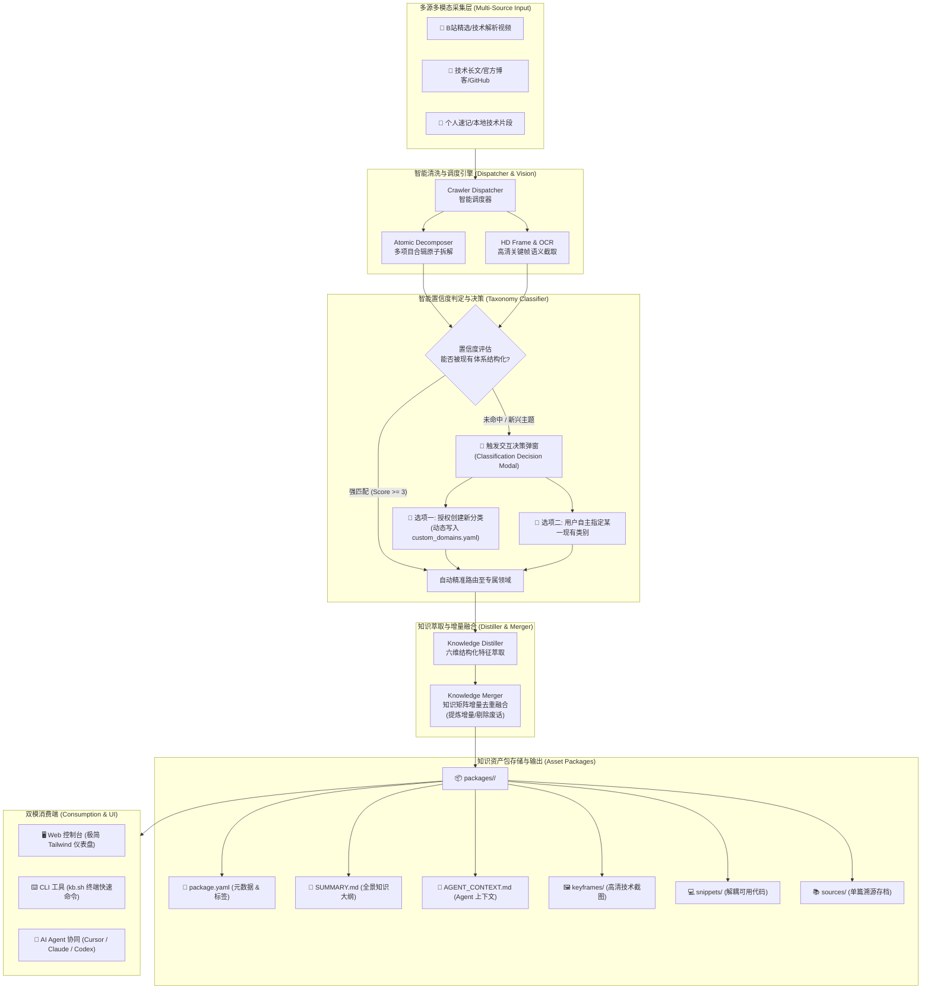

<div align="center">

<picture>
  <source media="(prefers-color-scheme: dark)" srcset="https://img.shields.io/badge/Logo-K-10b981?style=for-the-badge&logoColor=white">
  
</picture>

# 📦 知识资产中心 (Knowledge Assets Center)
### *Next-Gen Local Knowledge Distillation & Technical Asset Structuring Engine*

**下一代本地知识沉淀与技术资产重组引擎**  
*支持多模态视频/网页/速记智能抓取 · 原子化多项目拆解 · 结构化知识特征提取 · 增量去重融合 · 自动化资产包构建*

[](https://www.python.org/)
[](https://fastapi.tiangolo.com/)
[](https://tailwindcss.com/)
[](https://github.com)
[](https://git-scm.com/)
[](LICENSE)

[系统特性](#-核心设计理念与解决痛点) • [系统架构](#-系统架构全景) • [界面预览](#-交互界面与视觉设计) • [核心功能](#-六大核心功能模块) • [目录结构](#-纯净系统目录规范) • [快速上手](#-极速安装与快速上手) • [CLI 指南](#-cli-命令行全功能速查) • [Agent 对接](#-ai-agent-协同流)

---

</div>

## 💡 核心设计理念与解决痛点

在 AI 与开源爆发时代，传统的收藏夹、笔记软件与爬虫往往面临三大致命痛点：
1. **链接失效与图床防盗链**：单纯存链接，一旦原帖删除或外链防盗链生效，资料彻底丢失；
2. **粗暴文本堆砌与机械重复**：爬取十篇逆向或大模型文章，内容彼此雷同，关键踩坑点和核心参数被海量废话淹没；
3. **视频资料难检索、大文件占硬盘**：长达数十分钟的技术推荐视频（例如“本周10大开源项目”），无法定点定位到特定项目的关键帧截图，且不同领域的项目混杂一团。

**「知识资产中心」**专为解决上述问题而生，秉承以下黄金准则：
- 🔍 **要结构化萃取，不要原始废话**：自动抽取「核心功能」、「硬件配置」、「运行环境」、「能否本地」、「同类优势」、「避坑要点与合规红线」。
- ⚡ **原子化多向拆解**：一条 10 个项目的合辑视频，自动拆解为 10 个独立的技术资产，分别精准归流至各自领域资产包。
- 🧬 **增量去重融合**：同类文献二次入库时，自动对比现有知识矩阵，不重复建项，仅增量补全新增价值点。
- 🎯 **置信度判定与决策弹窗**：无法被现有体系精准分类时，绝不随意归档，主动弹出对话框让用户授权新建分类或自主指定。
- 🖼️ **高清关键帧定点截取**：严格零原视频占用，自动提取高清技术架构图与操作演示帧。

---

## 🏗️ 系统架构全景



---

## 🎨 交互界面与视觉设计

### 1. 现代化深色可视化控制台 (Web Dashboard)
采用沉浸式深灰/极黑玻璃拟态设计，顶栏搭载专属 **「K」** 徽标与 **「知识资产中心」** 品牌标：

```
┌──────────────────────────────────────────────────────────────────────────────────────────────┐
│  [ K ] 知识资产中心  Knowledge Assets Center           [ ⚡ 8 资产包 ]  [ 📚 12 实体 ]  [ Git: main ] │
├───────────────────────────────┬──────────────────────────────────────────────────────────────┤
│ 📂 知识领域全景分类导航       │ 📥 智能输入与知识萃取中心                                    │
│ ───────────────────────────── │ ┌──────────────────────────────────────────────────────────┐ │
│ 🌐 全部知识资产包             │ │ 输入采集 URL / B站视频 / 文章链接 / 粘贴速记文本...        │ │
│ 🤖 AI科技与大模型 (5)         │ └──────────────────────────────────────────────────────────┘ │
│    ⚡ 逆向工程与代码复刻      │ [ 智能识别所属领域 ▾ ]  [ 自动匹配子方向 ▾ ]  [ ⚡ 录入并重组 ] │
│    🧠 本地大模型推理优化      ├──────────────────────────────────────────────────────────────┤
│    🎬 AI视频与多模态创作      │ 📦 当前资产包: 逆向工程与自动化逻辑复刻                      │
│    🤖 智能体工作流自动化      │ ┌──────────────────────────────────────────────────────────┐ │
│    📊 架构可视化与技术图解    │ │ 📌 核心知识矩阵 (去重融合)                                 │ │
│ 📑 知识生产力与办公自动化 (1) │ │ • 【功能特性】AST 语法树重构与全自动化复刻逻辑...        │ │
│ 💼 商业与商业模式 (0)         │ │ • 【硬件配置】标准机器配置 (8G 内存即可无痛运行)           │ │
│ 🏛️ 建筑设计与空间计算 (1)     │ │ • 【能否本地】🟢 纯本地运行 (无强联网依赖)                 │ │
│ 🎨 三维与数字艺术 (0)         │ │ • 【同类优势】模块解耦度高，支持快速组合并嵌入工程流       │ │
│ ⚙️ 全栈工程与系统研发 (1)     │ │ • 【避坑要点】严格限定合法学习，严禁触碰混淆加壳对抗       │ │
│ 📥 待整理临时收件箱 (0)       │ └──────────────────────────────────────────────────────────┘ │
│                               │ 🖼️ 高清关键帧画廊 (Keyframes)                                │
│                               │ [ 截图 01: 架构流图 ]  [ 截图 02: 终端运行参数 ] ...         │
└───────────────────────────────┴──────────────────────────────────────────────────────────────┘
```

### 2. 分类未命中决策弹窗 (Interactive Decision Modal)
当录入内容无法被系统既有分类表精准匹配时，系统**拒绝随意污染分类**，即刻唤起交互弹窗：

```
┌────────────────────────────────────────────────────────────────────────┐
│  ⚠️ 未能精准匹配现有知识分类表                                  [ ✕ ] │
│  系统对该内容的分析未命中现有领域，请决策分类归属：                    │
├────────────────────────────────────────────────────────────────────────┤
│  📄 待入库实体: 《法式舒芙蕾与千层酥皮烘焙全流程技巧》                 │
│  摘要: 详细讲解法式经典烘焙制作中的蛋白霜打发硬度、温度与时间曲线...   │
├────────────────────────────────────────────────────────────────────────┤
│  🌟 选项一：我允许创建新的分类类别 (智能推荐)               [智能推荐] │
│     系统将根据您确认的名称，永久扩展分类体系并自动生成专属资产包：     │
│     一级所属领域名称: [ 美食烹饪与生活艺术                   ]         │
│     二级子方向名称:   [ 餐饮工艺与精品甜点                   ]         │
│     [ 🟢 允许并以新类别创建资产包入库 ]                                │
├────────────────────────────────────────────────────────────────────────┤
│  📌 选项二：我不允许，由我指定归入某一现有类别                         │
│     从当前分类体系中指定最符合的分类：                                 │
│     [ AI科技与大模型 > 架构可视化与技术图解               ▾ ]          │
│     [ 🔵 归入所选现有类别 ]                                            │
└────────────────────────────────────────────────────────────────────────┘
```

---

## 🌟 六大核心功能模块

### 1. ⚡ 多源智能采集与原子化多项拆解
- **合辑视频智能解构**：针对包含多个项目的长视频（如“本周推荐 10 个开源项目”），自动原子化拆解为 10 个独立的 `SubItem`。
- **精准独立路由**：每个项目分别归属其真正的技术领域（如 3D 渲染器归入三维艺术、Local LLM 归入端侧模型、DevOps 脚本归入工程运维）。
- **零冗余存储**：自动丢弃数 GB 的大视频文件，只留文字详解与高清晰度时间轴截图。

### 2. 🎯 置信度分类判定与用户决策闭环
- **多维度评分机制**：基于标题、摘要、标签与正文前 1000 字综合匹配，设立强关联阈值（得分 $\ge 3$ 或多关键词同时命中）。
- **人机协同扩展**：
  - 用户点击“允许创建新分类”后，新领域永久写入 `custom_domains.yaml`。
  - 用户选择“指定现有类别”后，自动将该条目并入对应资产包。

### 3. 🧬 结构化知识特征抽取与增量去重融合
- **告别流水账**：采用统一本体六维结构化模版抽取知识：
  1. `核心功能`：解决了什么核心问题与工作流。
  2. `硬件配置`：明确 GPU、显存、CPU、内存底线要求。
  3. `运行环境`：Docker、Node、Python 版本依赖。
  4. `能否本地`：是否具备离线脱网运行能力。
  5. `同类优势`：相比竞品的差异化长板。
  6. `避坑要点与合规红线`：合规边界、易踩环境坑、反面教训。
- **增量重组去重**：同方向新文章进来时，语义查重算法识别相似观点，合并重复信息，仅将独特的避坑点或参数作为增量追加。

### 4. 🖼️ 高清关键帧与视觉排错
- **语义画面捕获**：自动剔除片头片尾花字，截取包含控制台命令、系统架构图、核心参数界面的关键帧。
- **防盗链本地化**：所有截图持久化保存在专属资产包的 `keyframes/` 目录中，永久规避外链失效风险。

### 5. 📦 独立自洽的“资产包 (Asset Package)”格式
每个资产包均为独立目录，开箱即用：
```
packages/ai_tech_local_llm/
├── package.yaml        # 领域ID、子方向、标签、更新时间、知识矩阵
├── SUMMARY.md          # 聚合知识全景大纲 (含六维矩阵、避坑红线、图文精粹)
├── AGENT_CONTEXT.md    # 专为 AI Agent (Cursor / Codex) 优化的高浓度 Prompt
├── sources/            # 原始结构化 Markdown 溯源存档
├── keyframes/          # 本地高清关键帧截图 (*.jpg / *.png)
├── snippets/           # 解耦抽取的生产级可复用代码片段 (*.py / *.ts)
└── assets/             # 架构图、流程脑图等静态素材
```

### 6. 🔒 纯本地私有运行与 Git 原生版本管理
- **无云端绑定**：核心逻辑完全基于本地 Python 环境运行，不依赖任何第三方收费 SaaS。
- **自动化提交**：每次录入或增量更新，系统内建 Git 管理器自动生成规范化的提交记录（如 `feat(kb): ingest [webpage] ...`），知识演进全程可追溯。

---

## 📁 纯净系统目录规范

```
hermes_kb/
├── core/                         # 核心业务引擎
│   ├── package_manager.py        # 资产包路由、置信度分类与增量管理
│   ├── web_server.py             # FastAPI 控制台后端与现代 Web UI
│   ├── knowledge_distiller.py    # 六维结构化特征萃取引擎
│   ├── knowledge_merger.py       # 知识矩阵增量去重融合器
│   ├── git_manager.py            # 本地 Git 自动化版本管理
│   ├── video_vision.py           # 高清视频抽帧与视觉理解
│   └── screenshot_ocr.py         # 图像文字与架构图识别
├── crawlers/                     # 多源采集爬虫调度库
│   ├── base.py                   # IngestedItem 数据模型基类
│   ├── dispatcher.py             # URL 智能嗅探与协议分发器
│   ├── bilibili_video.py         # B站视频抽取与原子化多项拆解器
│   └── webpage.py                # 深度网页内容清洗与代码片段剥离
├── templates/                    # 自定义渲染模板
├── packages/                     # 知识资产包物理仓库 (默认纯净空目录，配 .gitkeep)
│   └── .gitkeep
├── config.py                     # 全局配置、八大基础分类体系与自定义领域持久化
├── cli.py                        # Typer 终端交互命令行工具
├── kb.sh                         # 一键管理启动脚本 (运行控制台/快捷命令)
├── requirements.txt              # 纯净生产环境依赖清单
└── README.md                     # 本项目系统设计与使用说明书
```

---

## 🚀 极速安装与快速上手

### 1. 环境准备
- **操作系统**：macOS / Linux / Windows (WSL)
- **Python 版本**：Python 3.10 及以上
- **系统工具**：`ffmpeg`（用于视频高清抽帧）
  - macOS: `brew install ffmpeg`
  - Ubuntu/Debian: `sudo apt install ffmpeg`

### 2. 克隆项目与安装依赖
```bash
# 克隆纯净版系统代码
git clone https://github.com/<your-username>/knowledge-assets-center.git
cd knowledge-assets-center

# 方式一：使用 uv 极速创建虚拟环境 (推荐)
uv venv .venv
source .venv/bin/activate
uv pip install -r requirements.txt

# 方式二：使用标准 Python venv
python3 -m venv .venv
source .venv/bin/activate
pip install -r requirements.txt
```

### 3. 一键启动 Web 可视化控制台
```bash
# 赋予启动脚本执行权限
chmod +x kb.sh

# 启动 Web 服务 (默认端口 8765)
./kb.sh serve

# 指定自定义端口启动
./kb.sh serve --port 9000
```
启动成功后，浏览器访问：👉 **http://127.0.0.1:8765** 即可进入可视化仪表盘。

---

## ⌨️ CLI 命令行全功能速查

知识资产中心提供强大的终端 CLI 工具，支持完全脱离浏览器高效操作：

| 任务场景 | 常用命令 | 功能描述 |
| :--- | :--- | :--- |
| **启动界面** | `./kb.sh serve` | 启动 Web 可视化控制台 |
| **采集长文** | `./kb.sh ingest "https://example.com/post"` | 抓取网页并自动匹配分类归包 |
| **采集视频** | `./kb.sh ingest "https://www.bilibili.com/video/BVxxx"` | 抓取视频，高清抽帧并原子拆解 |
| **手动速记** | `./kb.sh ingest "Docker 部署 Qwen2 本地踩坑要点..."` | 直接将文本笔记录入并结构化 |
| **指定领域** | `./kb.sh ingest "<URL>" --domain ai_tech` | 强制归入指定一级领域 |
| **列出资产** | `./kb.sh list` | 彩色表格查看所有资产包与实体数量 |
| **查看详情** | `./kb.sh show ai_tech_local_llm` | 终端富文本渲染资产包核心矩阵与避坑要点 |
| **导出上下文** | `./kb.sh export ai_tech_local_llm --target cursor` | 导出 Cursor 专用的 `.cursorrules` 上下文 |
| **一键剪贴板** | `./kb.sh export ai_tech_local_llm --copy` | 直接将资产包上下文复制到系统剪贴板 |

---

## 🤖 AI Agent 协同流

每个生成的资产包都天然具备供 AI 消费的高浓度知识接口：

### 1. 与 Cursor 深度集成
在你的项目根目录下执行导出：
```bash
./kb.sh export ai_reverse_pipeline --target cursor
```
系统将在当前项目中生成 `.cursor/rules/ai_reverse_pipeline.mdc`，Cursor 在编写相关代码时将自动遵循该知识资产包中沉淀的**环境约束、依赖版本与避坑合规要点**。

### 2. 与 Claude Code / Codex / LLM 协同
```bash
./kb.sh export ai_tech_local_llm --copy
```
系统自动将专为 LLM 提炼的 `AGENT_CONTEXT.md` 拷贝到系统剪贴板。直接在 Claude、GPT 或终端 Agent 输入框中 `Cmd+V` / `Ctrl+V` 粘贴，即可一键赋予 Agent 专精领域的深度上下文。

---

## 📄 开源许可证

本项目采用 [MIT 许可证](LICENSE)。欢迎自由分发、修改与部署私有化知识库。
