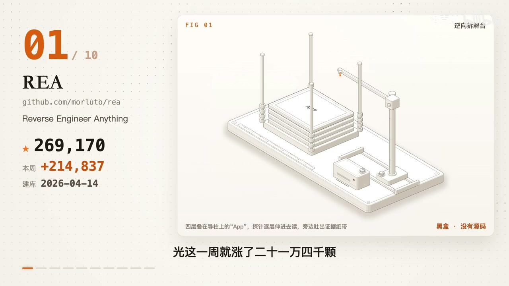

# 知识资产包：AI逆向分析与软件复刻流水线
> **资产包标识**: `ai_reverse_pipeline` | **一级领域**: 🤖 AI科技与大模型
> **收录资源数**: 3 篇/条 | **沉淀知识实体**: 1 个 | **更新时间**: 2026-10-27 05:28:02
> **定位阐述**: REA + Reverse-skill + PentAGI 自动化逆向、逻辑推演与 1:1 复刻工程流水线

---
## 🌟 核心技术与工程特性对比矩阵 (Structured Knowledge Matrix)
本表由系统从收录的各篇资料中自动抽取、去重并增量融合提炼而成：

| 核心方案/实体 | 核心定位与功能 | 💻 硬件配置要求 | 🌐 运行环境与依赖 | 🔒 能否本地离线运行 | ⚡ 同类核心优势 | ⚠️ 劣势与踩坑要点 | 👥 融合来源数 |
| :--- | :--- | :--- | :--- | :--- | :--- | :--- | :---: |
| **REA** | 核心解决痛点: 让 AI 逆向任何 App，一直拆到二进制；装上之后你的 AI 能多做什么: 让 AI 逆向任何 App，一直拆到二进制，显著突破传统工作流瓶颈。 | 硬件要求: 轻量级要求: 任意主流 Mac/PC (8G+内存，无需独显，轻量CPU即可) / 运行环境: Node.js (>= 18) + Python 3.10+ + Ghidra/IDA 反编译分析器 | 硬件要求: 轻量级要求: 任意主流 Mac/PC (8G + 内存，无需独显，轻量CPU即可) + 运行环境: Node.js (>= 18) + Python 3.10 + Ghidra/IDA 反编译分析器 + Docker 容器环境 + MCP (Model Context Protocol) 插件客户端 + 反编译分析器 (Ghidra / IDA) | 本地化支持: 🟢 100% 本地运行 (反编译、二进制分析与比对完全离线，模型推演支持 Ollama 本地部署) | • 【全自动端到端证据链】每一个反推的函数均配有反编译汇编与内存调用链证据，结论可逐项溯源核对。<br>• 【闭环编译验证】实测老游戏声道函数复刻，3200 组单元测试全覆盖，二进制产物 63 字节完全吻合。<br>• 【深入最底层】不仅拆解前端网页和桌面界面，还能一路探查到底层二进制机器码。 | • 【合规红线】严格限定合法学习或授权复刻，严禁对明确禁止逆向或商业加密混淆做对抗破解。<br>• 【复杂函数防幻觉】对极长未导出二进制函数需结合动态插桩验证，不能单凭 LLM 静态猜测。<br>• 【环境排错】多工具链依赖配置：Reverseskill 会判断这次该走哪条路，缺什么工具就装什么 [补充: 草稿鸭] | 3 篇融合 |

---

## 📋 深度结构化特征卡片详解 (Detailed Entities)
### 1. 方案实体: REA
- **🎯 核心功能与定位**: 核心解决痛点: 让 AI 逆向任何 App，一直拆到二进制；装上之后你的 AI 能多做什么: 让 AI 逆向任何 App，一直拆到二进制，显著突破传统工作流瓶颈。
- **💻 硬件配置规格**: `硬件要求: 轻量级要求: 任意主流 Mac/PC (8G+内存，无需独显，轻量CPU即可) / 运行环境: Node.js (>= 18) + Python 3.10+ + Ghidra/IDA 反编译分析器`
- **🌐 运行环境与依赖栈**: `硬件要求: 轻量级要求: 任意主流 Mac/PC (8G + 内存，无需独显，轻量CPU即可) + 运行环境: Node.js (>= 18) + Python 3.10 + Ghidra/IDA 反编译分析器 + Docker 容器环境 + MCP (Model Context Protocol) 插件客户端 + 反编译分析器 (Ghidra / IDA)`
- **🔒 本地化与隐私能力**: 本地化支持: 🟢 100% 本地运行 (反编译、二进制分析与比对完全离线，模型推演支持 Ollama 本地部署)
- **⚡ 同类对比核心优势**:
  - 【全自动端到端证据链】每一个反推的函数均配有反编译汇编与内存调用链证据，结论可逐项溯源核对。
  - 【闭环编译验证】实测老游戏声道函数复刻，3200 组单元测试全覆盖，二进制产物 63 字节完全吻合。
  - 【深入最底层】不仅拆解前端网页和桌面界面，还能一路探查到底层二进制机器码。
  - 【成熟生态】工具链模块解耦度高，支持快速组合并无缝嵌入现有工程流。 [补充: 草稿鸭]
  - 【结论可查】推演带证据链追溯：Codex 照着 REA 那份带证据的解释，用你熟悉的工具写一个属于你的版本 [补充: 草稿鸭]
- **⚠️ 劣势、边界与避坑踩坑要点**:
  - 【合规红线】严格限定合法学习或授权复刻，严禁对明确禁止逆向或商业加密混淆做对抗破解。
  - 【复杂函数防幻觉】对极长未导出二进制函数需结合动态插桩验证，不能单凭 LLM 静态猜测。
  - 【环境排错】多工具链依赖配置：Reverseskill 会判断这次该走哪条路，缺什么工具就装什么 [补充: 草稿鸭]
  - 【复刻边界】切忌盲目原样搬运；核心在于摸清行为逻辑后独立自研重写。 [补充: 草稿鸭]
  - 【安全界限】自动化工具仅提供初步分析，复杂业务逻辑与生产环境仍需人工专项复核。 [补充: 草稿鸭]
- **🛠️ 上手验证常用指令**:
  ```bash
  git clone https://github.com/morluto/rea
  ```
- **💡 实战心法与核心认知**:
  - 整件事分成四段，每段一个主力工具 (来源: 草稿鸭)
  - 四段走完，一个功能就复刻出来了 (来源: 草稿鸭)
  - 让它把差异列出来，按影响程度排个序，我们一次只处理一个问题 (来源: AI开源无界)
- **👥 知识贡献来源**: 洛克AI, 草稿鸭, AI开源无界

## 📦 沉淀代码片段与模板库索引 (Code Snippets)
- [`20261027_REA：让_AI_逆向任何_App，一直拆到二进制_snip_01.sh`](snippets/20261027_REA：让_AI_逆向任何_App，一直拆到二进制_snip_01.sh)

## 🖼️ 核心视频关键帧与视觉画廊 (Keyframes Gallery)
共沉淀 **2** 张高清关键帧画面，零原视频体积，直观展示实操界面与关键节点：
- 
- 

## 📚 原始知识本地脱机存档清单 (Local Offline Archives)
> 提示：所有正文、代码与排版均已 100% 离线克隆至本地 Git 仓库，外部链接失效亦可永久脱机查阅：
- 🎬 [B站视频详解] **[REA：让 AI 逆向任何 App，一直拆到二进制](sources/20261027_bilibili_video_REA：让_AI_逆向任何_App，一直拆到二进制.md)** —— *作者: 洛克AI* | [原始链接](https://www.bilibili.com/video/BV1UAn36aEX3?t=35)
- 📄 [微信公众号] **[REA + Reverse-skill + PentAGI复刻任何软件](sources/20261026_wechat_article_REA_+_Reverse-skill_+_PentAGI复刻任何软件.md)** `[已去重增量融合]` —— *作者: 草稿鸭* | [原始链接](https://mp.weixin.qq.com/s/dK_p1fHAQA3u-zbn5er7ZA)
- 📄 [微信公众号] **[我把 3 个 Star 过万的 Skill 串起来，搭了一条能“复刻任意软件”的流水线](sources/20261026_wechat_article_我把_3_个_Star_过万的_Skill_串起来，搭了一条能“复刻任意软件”的流水线.md)** `[已去重增量融合]` —— *作者: AI开源无界* | [原始链接](https://mp.weixin.qq.com/s/bs7SwRd7GrVEiaI_ARDP0g)
