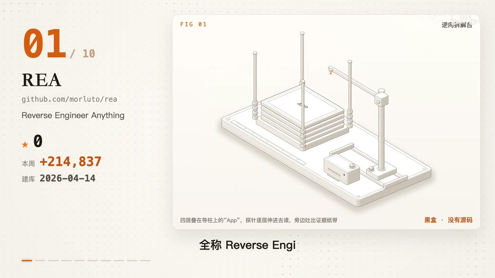
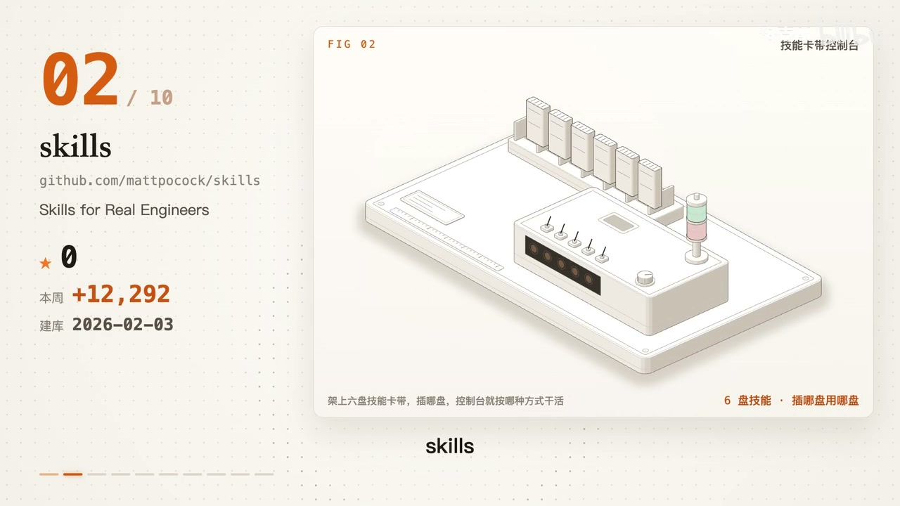
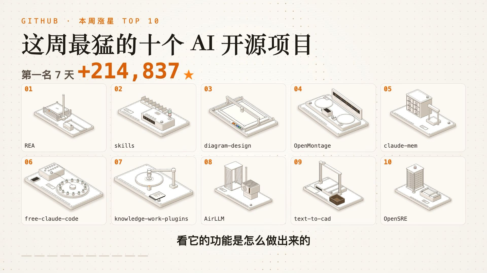

# 知识资产包：AI视频与多模态创作知识资产包
> **资产包标识**: `ai_tech_ai_video` | **一级领域**: 🤖 AI科技与大模型
> **收录资源数**: 11 篇/条 | **沉淀知识实体**: 8 个 | **更新时间**: 2026-10-27 04:47:11
> **定位阐述**: AI科技与大模型 > AI视频与多模态创作 专题领域沉淀

---
## 🌟 核心技术与工程特性对比矩阵 (Structured Knowledge Matrix)
本表由系统从收录的各篇资料中自动抽取、去重并增量融合提炼而成：

| 核心方案/实体 | 核心定位与功能 | 💻 硬件配置要求 | 🌐 运行环境与依赖 | 🔒 能否本地离线运行 | ⚡ 同类核心优势 | ⚠️ 劣势与踩坑要点 | 👥 融合来源数 |
| :--- | :--- | :--- | :--- | :--- | :--- | :--- | :---: |
| **这周 GitHub 上涨星最猛的 10 ** | 围绕 这周 GitHub 上涨星最猛的 10  打造的全自动化逻辑推演与工程实现工作流 | ram | 跨平台标准环境 (支持 macOS / Linux / Windows) | 🟡 混合架构 (分析/逆向工具本地离线执行，逻辑推演重写依赖 AI 编程助手) | • 【成熟生态】工具链模块解耦度高，支持快速组合并无缝嵌入现有工程流。<br>• 【透明推演】输出具备完整的上下文依据与调用日志，结论可二次逐项核对。<br>• 【干净复刻】基于行为推演重写自主版本，有效规避版权与混淆对抗风险。 | • 【合规红线】严格限定合法学习或授权复刻，严禁对明确禁止逆向或商业加密混淆做对抗。<br>• 【环境排错】涉及多工具串联，遇到报错应保留完整日志并逐项单点排查，切忌全量同时修改。<br>• 【复刻边界】切忌盲目原样搬运代码或素材；复刻核心在于摸清行为逻辑后独立自研重写。 | 1 篇融合 |
| **REA** | 围绕 REA 打造的全自动化逻辑推演与工程实现工作流 | ram | 跨平台标准环境 (支持 macOS / Linux / Windows) | 🟢 本地命令行/独立工具 (无强联网依赖) | • 【成熟生态】工具链模块解耦度高，支持快速组合并无缝嵌入现有工程流。<br>• 【透明推演】输出具备完整的上下文依据与调用日志，结论可二次逐项核对。<br>• 【干净复刻】基于行为推演重写自主版本，有效规避版权与混淆对抗风险。 | • 【合规红线】严格限定合法学习或授权复刻，严禁对明确禁止逆向或商业加密混淆做对抗。<br>• 【环境排错】涉及多工具串联，遇到报错应保留完整日志并逐项单点排查，切忌全量同时修改。<br>• 【复刻边界】切忌盲目原样搬运代码或素材；复刻核心在于摸清行为逻辑后独立自研重写。 | 1 篇融合 |
| **skills：让 AI 先问清楚、再写测** | 围绕 skills：让 AI 先问清楚、再写测 打造的全自动化逻辑推演与工程实现工作流 | ram | 跨平台标准环境 (支持 macOS / Linux / Windows) | 🟢 本地命令行/独立工具 (无强联网依赖) | • 【成熟生态】工具链模块解耦度高，支持快速组合并无缝嵌入现有工程流。<br>• 【透明推演】输出具备完整的上下文依据与调用日志，结论可二次逐项核对。<br>• 【干净复刻】基于行为推演重写自主版本，有效规避版权与混淆对抗风险。 | • 【合规红线】严格限定合法学习或授权复刻，严禁对明确禁止逆向或商业加密混淆做对抗。<br>• 【环境排错】涉及多工具串联，遇到报错应保留完整日志并逐项单点排查，切忌全量同时修改。<br>• 【复刻边界】切忌盲目原样搬运代码或素材；复刻核心在于摸清行为逻辑后独立自研重写。 | 3 篇融合 |
| **diagram-design：一句话让 ** | 围绕 diagram-design：一句话让  打造的全自动化逻辑推演与工程实现工作流 | ram | 跨平台标准环境 (支持 macOS / Linux / Windows) | 🟢 本地命令行/独立工具 (无强联网依赖) | • 【成熟生态】工具链模块解耦度高，支持快速组合并无缝嵌入现有工程流。<br>• 【透明推演】输出具备完整的上下文依据与调用日志，结论可二次逐项核对。<br>• 【干净复刻】基于行为推演重写自主版本，有效规避版权与混淆对抗风险。 | • 【合规红线】严格限定合法学习或授权复刻，严禁对明确禁止逆向或商业加密混淆做对抗。<br>• 【环境排错】涉及多工具串联，遇到报错应保留完整日志并逐项单点排查，切忌全量同时修改。<br>• 【复刻边界】切忌盲目原样搬运代码或素材；复刻核心在于摸清行为逻辑后独立自研重写。 | 1 篇融合 |
| **Claude** | 围绕 Claude 打造的全自动化逻辑推演与工程实现工作流 | ram | 跨平台标准环境 (支持 macOS / Linux / Windows) | 🟡 混合架构 (分析/逆向工具本地离线执行，逻辑推演重写依赖 AI 编程助手) | • 【成熟生态】工具链模块解耦度高，支持快速组合并无缝嵌入现有工程流。<br>• 【透明推演】输出具备完整的上下文依据与调用日志，结论可二次逐项核对。<br>• 【干净复刻】基于行为推演重写自主版本，有效规避版权与混淆对抗风险。 | • 【合规红线】严格限定合法学习或授权复刻，严禁对明确禁止逆向或商业加密混淆做对抗。<br>• 【环境排错】涉及多工具串联，遇到报错应保留完整日志并逐项单点排查，切忌全量同时修改。<br>• 【复刻边界】切忌盲目原样搬运代码或素材；复刻核心在于摸清行为逻辑后独立自研重写。 | 2 篇融合 |
| **knowledge-work-plugi** | 围绕 knowledge-work-plugi 打造的全自动化逻辑推演与工程实现工作流 | ram | 跨平台标准环境 (支持 macOS / Linux / Windows) | 🟢 本地命令行/独立工具 (无强联网依赖) | • 【成熟生态】工具链模块解耦度高，支持快速组合并无缝嵌入现有工程流。<br>• 【透明推演】输出具备完整的上下文依据与调用日志，结论可二次逐项核对。<br>• 【干净复刻】基于行为推演重写自主版本，有效规避版权与混淆对抗风险。 | • 【合规红线】严格限定合法学习或授权复刻，严禁对明确禁止逆向或商业加密混淆做对抗。<br>• 【环境排错】涉及多工具串联，遇到报错应保留完整日志并逐项单点排查，切忌全量同时修改。<br>• 【复刻边界】切忌盲目原样搬运代码或素材；复刻核心在于摸清行为逻辑后独立自研重写。 | 1 篇融合 |
| **AirLLM：4GB 显卡跑 70B 大** | 围绕 AirLLM：4GB 显卡跑 70B 大 打造的全自动化逻辑推演与工程实现工作流 | ram | 跨平台标准环境 (支持 macOS / Linux / Windows) | 🟢 本地命令行/独立工具 (无强联网依赖) | • 【成熟生态】工具链模块解耦度高，支持快速组合并无缝嵌入现有工程流。<br>• 【透明推演】输出具备完整的上下文依据与调用日志，结论可二次逐项核对。<br>• 【干净复刻】基于行为推演重写自主版本，有效规避版权与混淆对抗风险。 | • 【合规红线】严格限定合法学习或授权复刻，严禁对明确禁止逆向或商业加密混淆做对抗。<br>• 【环境排错】涉及多工具串联，遇到报错应保留完整日志并逐项单点排查，切忌全量同时修改。<br>• 【复刻边界】切忌盲目原样搬运代码或素材；复刻核心在于摸清行为逻辑后独立自研重写。 | 1 篇融合 |
| **text-to-cad：一句话生成能加工** | 围绕 text-to-cad：一句话生成能加工 打造的全自动化逻辑推演与工程实现工作流 | ram | 跨平台标准环境 (支持 macOS / Linux / Windows) | 🟢 本地命令行/独立工具 (无强联网依赖) | • 【成熟生态】工具链模块解耦度高，支持快速组合并无缝嵌入现有工程流。<br>• 【透明推演】输出具备完整的上下文依据与调用日志，结论可二次逐项核对。<br>• 【干净复刻】基于行为推演重写自主版本，有效规避版权与混淆对抗风险。 | • 【合规红线】严格限定合法学习或授权复刻，严禁对明确禁止逆向或商业加密混淆做对抗。<br>• 【环境排错】涉及多工具串联，遇到报错应保留完整日志并逐项单点排查，切忌全量同时修改。<br>• 【复刻边界】切忌盲目原样搬运代码或素材；复刻核心在于摸清行为逻辑后独立自研重写。 | 1 篇融合 |

---

## 📋 深度结构化特征卡片详解 (Detailed Entities)
### 1. 方案实体: 这周 GitHub 上涨星最猛的 10 
- **🎯 核心功能与定位**: 围绕 这周 GitHub 上涨星最猛的 10  打造的全自动化逻辑推演与工程实现工作流
- **💻 硬件配置规格**: `ram`
- **🌐 运行环境与依赖栈**: `跨平台标准环境 (支持 macOS / Linux / Windows)`
- **🔒 本地化与隐私能力**: 🟡 混合架构 (分析/逆向工具本地离线执行，逻辑推演重写依赖 AI 编程助手)
- **⚡ 同类对比核心优势**:
  - 【成熟生态】工具链模块解耦度高，支持快速组合并无缝嵌入现有工程流。
  - 【透明推演】输出具备完整的上下文依据与调用日志，结论可二次逐项核对。
  - 【干净复刻】基于行为推演重写自主版本，有效规避版权与混淆对抗风险。
  - 【端到端协同】从目标分析、环境依赖配齐到安全初筛，构建一体化工作流。
- **⚠️ 劣势、边界与避坑踩坑要点**:
  - 【合规红线】严格限定合法学习或授权复刻，严禁对明确禁止逆向或商业加密混淆做对抗。
  - 【环境排错】涉及多工具串联，遇到报错应保留完整日志并逐项单点排查，切忌全量同时修改。
  - 【复刻边界】切忌盲目原样搬运代码或素材；复刻核心在于摸清行为逻辑后独立自研重写。
  - 【安全界限】自动化工具仅提供初步扫描，业务逻辑漏洞与敏感权限仍需人工专项复核。
- **🛠️ 上手验证常用指令**:
  ```bash
  git clone https://github.com/morluto/rea
  ```
  ```bash
  git clone https://github.com/mattpocock/skills
  ```
  ```bash
  git clone https://github.com/cathrynlavery/diagram-design
  ```
  ```bash
  git clone https://github.com/calesthio/OpenMontage
  ```
- **👥 知识贡献来源**: 洛克AI

### 2. 方案实体: REA
- **🎯 核心功能与定位**: 围绕 REA 打造的全自动化逻辑推演与工程实现工作流
- **💻 硬件配置规格**: `ram`
- **🌐 运行环境与依赖栈**: `跨平台标准环境 (支持 macOS / Linux / Windows)`
- **🔒 本地化与隐私能力**: 🟢 本地命令行/独立工具 (无强联网依赖)
- **⚡ 同类对比核心优势**:
  - 【成熟生态】工具链模块解耦度高，支持快速组合并无缝嵌入现有工程流。
  - 【透明推演】输出具备完整的上下文依据与调用日志，结论可二次逐项核对。
  - 【干净复刻】基于行为推演重写自主版本，有效规避版权与混淆对抗风险。
  - 【端到端协同】从目标分析、环境依赖配齐到安全初筛，构建一体化工作流。
- **⚠️ 劣势、边界与避坑踩坑要点**:
  - 【合规红线】严格限定合法学习或授权复刻，严禁对明确禁止逆向或商业加密混淆做对抗。
  - 【环境排错】涉及多工具串联，遇到报错应保留完整日志并逐项单点排查，切忌全量同时修改。
  - 【复刻边界】切忌盲目原样搬运代码或素材；复刻核心在于摸清行为逻辑后独立自研重写。
  - 【安全界限】自动化工具仅提供初步扫描，业务逻辑漏洞与敏感权限仍需人工专项复核。
- **👥 知识贡献来源**: 洛克AI

### 3. 方案实体: skills：让 AI 先问清楚、再写测
- **🎯 核心功能与定位**: 围绕 skills：让 AI 先问清楚、再写测 打造的全自动化逻辑推演与工程实现工作流
- **💻 硬件配置规格**: `ram`
- **🌐 运行环境与依赖栈**: `跨平台标准环境 (支持 macOS / Linux / Windows)`
- **🔒 本地化与隐私能力**: 🟢 本地命令行/独立工具 (无强联网依赖)
- **⚡ 同类对比核心优势**:
  - 【成熟生态】工具链模块解耦度高，支持快速组合并无缝嵌入现有工程流。
  - 【透明推演】输出具备完整的上下文依据与调用日志，结论可二次逐项核对。
  - 【干净复刻】基于行为推演重写自主版本，有效规避版权与混淆对抗风险。
  - 【端到端协同】从目标分析、环境依赖配齐到安全初筛，构建一体化工作流。
- **⚠️ 劣势、边界与避坑踩坑要点**:
  - 【合规红线】严格限定合法学习或授权复刻，严禁对明确禁止逆向或商业加密混淆做对抗。
  - 【环境排错】涉及多工具串联，遇到报错应保留完整日志并逐项单点排查，切忌全量同时修改。
  - 【复刻边界】切忌盲目原样搬运代码或素材；复刻核心在于摸清行为逻辑后独立自研重写。
  - 【安全界限】自动化工具仅提供初步扫描，业务逻辑漏洞与敏感权限仍需人工专项复核。
- **👥 知识贡献来源**: 洛克AI

### 4. 方案实体: diagram-design：一句话让 
- **🎯 核心功能与定位**: 围绕 diagram-design：一句话让  打造的全自动化逻辑推演与工程实现工作流
- **💻 硬件配置规格**: `ram`
- **🌐 运行环境与依赖栈**: `跨平台标准环境 (支持 macOS / Linux / Windows)`
- **🔒 本地化与隐私能力**: 🟢 本地命令行/独立工具 (无强联网依赖)
- **⚡ 同类对比核心优势**:
  - 【成熟生态】工具链模块解耦度高，支持快速组合并无缝嵌入现有工程流。
  - 【透明推演】输出具备完整的上下文依据与调用日志，结论可二次逐项核对。
  - 【干净复刻】基于行为推演重写自主版本，有效规避版权与混淆对抗风险。
  - 【端到端协同】从目标分析、环境依赖配齐到安全初筛，构建一体化工作流。
- **⚠️ 劣势、边界与避坑踩坑要点**:
  - 【合规红线】严格限定合法学习或授权复刻，严禁对明确禁止逆向或商业加密混淆做对抗。
  - 【环境排错】涉及多工具串联，遇到报错应保留完整日志并逐项单点排查，切忌全量同时修改。
  - 【复刻边界】切忌盲目原样搬运代码或素材；复刻核心在于摸清行为逻辑后独立自研重写。
  - 【安全界限】自动化工具仅提供初步扫描，业务逻辑漏洞与敏感权限仍需人工专项复核。
- **👥 知识贡献来源**: 洛克AI

### 5. 方案实体: Claude
- **🎯 核心功能与定位**: 围绕 Claude 打造的全自动化逻辑推演与工程实现工作流
- **💻 硬件配置规格**: `ram`
- **🌐 运行环境与依赖栈**: `跨平台标准环境 (支持 macOS / Linux / Windows)`
- **🔒 本地化与隐私能力**: 🟡 混合架构 (分析/逆向工具本地离线执行，逻辑推演重写依赖 AI 编程助手)
- **⚡ 同类对比核心优势**:
  - 【成熟生态】工具链模块解耦度高，支持快速组合并无缝嵌入现有工程流。
  - 【透明推演】输出具备完整的上下文依据与调用日志，结论可二次逐项核对。
  - 【干净复刻】基于行为推演重写自主版本，有效规避版权与混淆对抗风险。
  - 【端到端协同】从目标分析、环境依赖配齐到安全初筛，构建一体化工作流。
- **⚠️ 劣势、边界与避坑踩坑要点**:
  - 【合规红线】严格限定合法学习或授权复刻，严禁对明确禁止逆向或商业加密混淆做对抗。
  - 【环境排错】涉及多工具串联，遇到报错应保留完整日志并逐项单点排查，切忌全量同时修改。
  - 【复刻边界】切忌盲目原样搬运代码或素材；复刻核心在于摸清行为逻辑后独立自研重写。
  - 【安全界限】自动化工具仅提供初步扫描，业务逻辑漏洞与敏感权限仍需人工专项复核。
- **👥 知识贡献来源**: 洛克AI

### 6. 方案实体: knowledge-work-plugi
- **🎯 核心功能与定位**: 围绕 knowledge-work-plugi 打造的全自动化逻辑推演与工程实现工作流
- **💻 硬件配置规格**: `ram`
- **🌐 运行环境与依赖栈**: `跨平台标准环境 (支持 macOS / Linux / Windows)`
- **🔒 本地化与隐私能力**: 🟢 本地命令行/独立工具 (无强联网依赖)
- **⚡ 同类对比核心优势**:
  - 【成熟生态】工具链模块解耦度高，支持快速组合并无缝嵌入现有工程流。
  - 【透明推演】输出具备完整的上下文依据与调用日志，结论可二次逐项核对。
  - 【干净复刻】基于行为推演重写自主版本，有效规避版权与混淆对抗风险。
  - 【端到端协同】从目标分析、环境依赖配齐到安全初筛，构建一体化工作流。
- **⚠️ 劣势、边界与避坑踩坑要点**:
  - 【合规红线】严格限定合法学习或授权复刻，严禁对明确禁止逆向或商业加密混淆做对抗。
  - 【环境排错】涉及多工具串联，遇到报错应保留完整日志并逐项单点排查，切忌全量同时修改。
  - 【复刻边界】切忌盲目原样搬运代码或素材；复刻核心在于摸清行为逻辑后独立自研重写。
  - 【安全界限】自动化工具仅提供初步扫描，业务逻辑漏洞与敏感权限仍需人工专项复核。
- **👥 知识贡献来源**: 洛克AI

### 7. 方案实体: AirLLM：4GB 显卡跑 70B 大
- **🎯 核心功能与定位**: 围绕 AirLLM：4GB 显卡跑 70B 大 打造的全自动化逻辑推演与工程实现工作流
- **💻 硬件配置规格**: `ram`
- **🌐 运行环境与依赖栈**: `跨平台标准环境 (支持 macOS / Linux / Windows)`
- **🔒 本地化与隐私能力**: 🟢 本地命令行/独立工具 (无强联网依赖)
- **⚡ 同类对比核心优势**:
  - 【成熟生态】工具链模块解耦度高，支持快速组合并无缝嵌入现有工程流。
  - 【透明推演】输出具备完整的上下文依据与调用日志，结论可二次逐项核对。
  - 【干净复刻】基于行为推演重写自主版本，有效规避版权与混淆对抗风险。
  - 【端到端协同】从目标分析、环境依赖配齐到安全初筛，构建一体化工作流。
- **⚠️ 劣势、边界与避坑踩坑要点**:
  - 【合规红线】严格限定合法学习或授权复刻，严禁对明确禁止逆向或商业加密混淆做对抗。
  - 【环境排错】涉及多工具串联，遇到报错应保留完整日志并逐项单点排查，切忌全量同时修改。
  - 【复刻边界】切忌盲目原样搬运代码或素材；复刻核心在于摸清行为逻辑后独立自研重写。
  - 【安全界限】自动化工具仅提供初步扫描，业务逻辑漏洞与敏感权限仍需人工专项复核。
- **👥 知识贡献来源**: 洛克AI

### 8. 方案实体: text-to-cad：一句话生成能加工
- **🎯 核心功能与定位**: 围绕 text-to-cad：一句话生成能加工 打造的全自动化逻辑推演与工程实现工作流
- **💻 硬件配置规格**: `ram`
- **🌐 运行环境与依赖栈**: `跨平台标准环境 (支持 macOS / Linux / Windows)`
- **🔒 本地化与隐私能力**: 🟢 本地命令行/独立工具 (无强联网依赖)
- **⚡ 同类对比核心优势**:
  - 【成熟生态】工具链模块解耦度高，支持快速组合并无缝嵌入现有工程流。
  - 【透明推演】输出具备完整的上下文依据与调用日志，结论可二次逐项核对。
  - 【干净复刻】基于行为推演重写自主版本，有效规避版权与混淆对抗风险。
  - 【端到端协同】从目标分析、环境依赖配齐到安全初筛，构建一体化工作流。
- **⚠️ 劣势、边界与避坑踩坑要点**:
  - 【合规红线】严格限定合法学习或授权复刻，严禁对明确禁止逆向或商业加密混淆做对抗。
  - 【环境排错】涉及多工具串联，遇到报错应保留完整日志并逐项单点排查，切忌全量同时修改。
  - 【复刻边界】切忌盲目原样搬运代码或素材；复刻核心在于摸清行为逻辑后独立自研重写。
  - 【安全界限】自动化工具仅提供初步扫描，业务逻辑漏洞与敏感权限仍需人工专项复核。
- **👥 知识贡献来源**: 洛克AI

## 📦 沉淀代码片段与模板库索引 (Code Snippets)
- [`20261027_AirLLM：4GB_显卡跑_70B_大模型_snip_01.sh`](snippets/20261027_AirLLM：4GB_显卡跑_70B_大模型_snip_01.sh)
- [`20261027_OpenMontage：把_AI_编程助手变成视频工作室_snip_01.sh`](snippets/20261027_OpenMontage：把_AI_编程助手变成视频工作室_snip_01.sh)
- [`20261027_OpenSRE：让_AI_帮你排查线上故障_snip_01.sh`](snippets/20261027_OpenSRE：让_AI_帮你排查线上故障_snip_01.sh)
- [`20261027_REA：让_AI_逆向任何_App，一直拆到二进制_snip_01.sh`](snippets/20261027_REA：让_AI_逆向任何_App，一直拆到二进制_snip_01.sh)
- [`20261027_claude-mem：给_AI_加上跨对话的长期记忆_snip_01.sh`](snippets/20261027_claude-mem：给_AI_加上跨对话的长期记忆_snip_01.sh)
- [`20261027_diagram-design：一句话让_AI_画出专业图解_snip_01.sh`](snippets/20261027_diagram-design：一句话让_AI_画出专业图解_snip_01.sh)
- [`20261027_free-claude-code：用免费额度跑_Claude_Code_这类编程工具_snip_01.sh`](snippets/20261027_free-claude-code：用免费额度跑_Claude_Code_这类编程工具_snip_01.sh)
- [`20261027_knowledge-work-plugins：Anthropic_官方出的_11_个岗位插件_snip_01.sh`](snippets/20261027_knowledge-work-plugins：Anthropic_官方出的_11_个岗位插件_snip_01.sh)
- [`20261027_skills：让_AI_先问清楚、再写测试的编程技能包_snip_01.sh`](snippets/20261027_skills：让_AI_先问清楚、再写测试的编程技能包_snip_01.sh)
- [`20261027_text-to-cad：一句话生成能加工的_3D_零件_snip_01.sh`](snippets/20261027_text-to-cad：一句话生成能加工的_3D_零件_snip_01.sh)
- [`20261027_这周_GitHub_上涨星最猛的_10_个_AI_开源项目_snip_01.sh`](snippets/20261027_这周_GitHub_上涨星最猛的_10_个_AI_开源项目_snip_01.sh)
- [`20261027_这周_GitHub_上涨星最猛的_10_个_AI_开源项目_snip_02.sh`](snippets/20261027_这周_GitHub_上涨星最猛的_10_个_AI_开源项目_snip_02.sh)
- [`20261027_这周_GitHub_上涨星最猛的_10_个_AI_开源项目_snip_03.sh`](snippets/20261027_这周_GitHub_上涨星最猛的_10_个_AI_开源项目_snip_03.sh)
- [`20261027_这周_GitHub_上涨星最猛的_10_个_AI_开源项目_snip_04.sh`](snippets/20261027_这周_GitHub_上涨星最猛的_10_个_AI_开源项目_snip_04.sh)
- [`20261027_这周_GitHub_上涨星最猛的_10_个_AI_开源项目_snip_05.sh`](snippets/20261027_这周_GitHub_上涨星最猛的_10_个_AI_开源项目_snip_05.sh)
- [`20261027_这周_GitHub_上涨星最猛的_10_个_AI_开源项目_snip_06.sh`](snippets/20261027_这周_GitHub_上涨星最猛的_10_个_AI_开源项目_snip_06.sh)
- [`20261027_这周_GitHub_上涨星最猛的_10_个_AI_开源项目_snip_07.sh`](snippets/20261027_这周_GitHub_上涨星最猛的_10_个_AI_开源项目_snip_07.sh)
- [`20261027_这周_GitHub_上涨星最猛的_10_个_AI_开源项目_snip_08.sh`](snippets/20261027_这周_GitHub_上涨星最猛的_10_个_AI_开源项目_snip_08.sh)
- [`20261027_这周_GitHub_上涨星最猛的_10_个_AI_开源项目_snip_09.sh`](snippets/20261027_这周_GitHub_上涨星最猛的_10_个_AI_开源项目_snip_09.sh)
- [`20261027_这周_GitHub_上涨星最猛的_10_个_AI_开源项目_snip_10.sh`](snippets/20261027_这周_GitHub_上涨星最猛的_10_个_AI_开源项目_snip_10.sh)

## 🖼️ 核心视频关键帧与视觉画廊 (Keyframes Gallery)
共沉淀 **10** 张高清关键帧画面，零原视频体积，直观展示实操界面与关键节点：
- 
- 
- 
- 
- 
- 
- 
- 

## 📚 原始知识本地脱机存档清单 (Local Offline Archives)
> 提示：所有正文、代码与排版均已 100% 离线克隆至本地 Git 仓库，外部链接失效亦可永久脱机查阅：
- 🎬 [B站视频详解] **[OpenSRE：让 AI 帮你排查线上故障](sources/20261027_bilibili_video_OpenSRE：让_AI_帮你排查线上故障.md)** `[已去重增量融合]` —— *作者: 洛克AI* | [原始链接](https://www.bilibili.com/video/BV1UAn36aEX3?t=568)
- 🎬 [B站视频详解] **[text-to-cad：一句话生成能加工的 3D 零件](sources/20261027_bilibili_video_text-to-cad：一句话生成能加工的_3D_零件.md)** —— *作者: 洛克AI* | [原始链接](https://www.bilibili.com/video/BV1UAn36aEX3?t=513)
- 🎬 [B站视频详解] **[AirLLM：4GB 显卡跑 70B 大模型](sources/20261027_bilibili_video_AirLLM：4GB_显卡跑_70B_大模型.md)** —— *作者: 洛克AI* | [原始链接](https://www.bilibili.com/video/BV1UAn36aEX3?t=449)
- 🎬 [B站视频详解] **[knowledge-work-plugins：Anthropic 官方出的 11 个岗位插件](sources/20261027_bilibili_video_knowledge-work-plugins：Anthropic_官方出的_11_个岗位插件.md)** —— *作者: 洛克AI* | [原始链接](https://www.bilibili.com/video/BV1UAn36aEX3?t=389)
- 🎬 [B站视频详解] **[free-claude-code：用免费额度跑 Claude Code 这类编程工具](sources/20261027_bilibili_video_free-claude-code：用免费额度跑_Claude_Code_这类编程工具.md)** `[已去重增量融合]` —— *作者: 洛克AI* | [原始链接](https://www.bilibili.com/video/BV1UAn36aEX3?t=329)
- 🎬 [B站视频详解] **[claude-mem：给 AI 加上跨对话的长期记忆](sources/20261027_bilibili_video_claude-mem：给_AI_加上跨对话的长期记忆.md)** —— *作者: 洛克AI* | [原始链接](https://www.bilibili.com/video/BV1UAn36aEX3?t=278)
- 🎬 [B站视频详解] **[OpenMontage：把 AI 编程助手变成视频工作室](sources/20261027_bilibili_video_OpenMontage：把_AI_编程助手变成视频工作室.md)** `[已去重增量融合]` —— *作者: 洛克AI* | [原始链接](https://www.bilibili.com/video/BV1UAn36aEX3?t=219)
- 🎬 [B站视频详解] **[diagram-design：一句话让 AI 画出专业图解](sources/20261027_bilibili_video_diagram-design：一句话让_AI_画出专业图解.md)** —— *作者: 洛克AI* | [原始链接](https://www.bilibili.com/video/BV1UAn36aEX3?t=162)
- 🎬 [B站视频详解] **[skills：让 AI 先问清楚、再写测试的编程技能包](sources/20261027_bilibili_video_skills：让_AI_先问清楚、再写测试的编程技能包.md)** —— *作者: 洛克AI* | [原始链接](https://www.bilibili.com/video/BV1UAn36aEX3?t=101)
- 🎬 [B站视频详解] **[REA：让 AI 逆向任何 App，一直拆到二进制](sources/20261027_bilibili_video_REA：让_AI_逆向任何_App，一直拆到二进制.md)** —— *作者: 洛克AI* | [原始链接](https://www.bilibili.com/video/BV1UAn36aEX3?t=35)
- 🎬 [B站视频详解] **[这周 GitHub 上涨星最猛的 10 个 AI 开源项目](sources/20261027_bilibili_video_这周_GitHub_上涨星最猛的_10_个_AI_开源项目.md)** —— *作者: 洛克AI* | [原始链接](https://www.bilibili.com/video/BV1UAn36aEX3)
