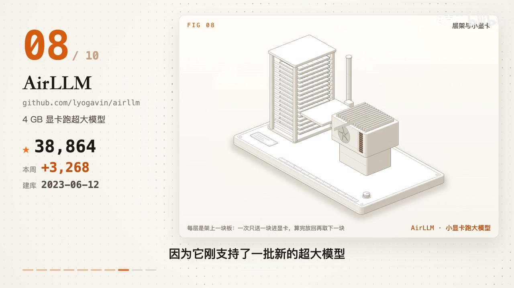
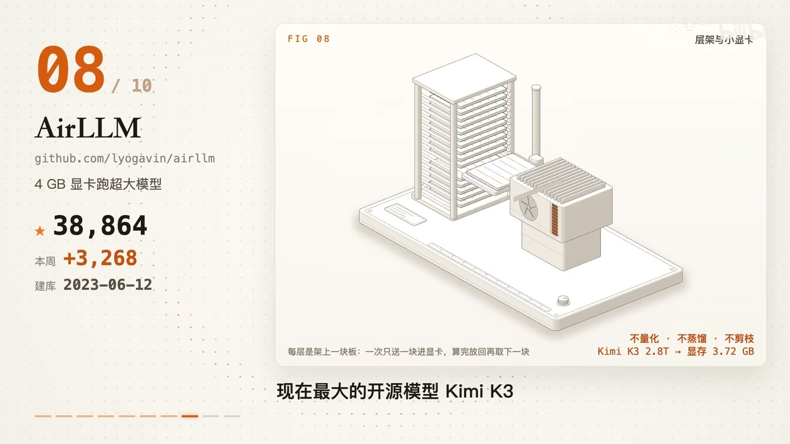

# 知识资产包：端侧推理与极限显存优化 (AirLLM 70B)
> **资产包标识**: `ai_tech_local_llm` | **一级领域**: 🤖 AI科技与大模型
> **收录资源数**: 1 篇/条 | **沉淀知识实体**: 1 个 | **更新时间**: 2026-10-29 03:00:53
> **定位阐述**: 基于权重分层加载与量化，实现消费级单卡 4GB 显存运行 70B 大模型

---
## 🌟 核心技术与工程特性对比矩阵 (Structured Knowledge Matrix)
本表由系统从收录的各篇资料中自动抽取、去重并增量融合提炼而成：

| 核心方案/实体 | 核心定位与功能 | 💻 硬件配置要求 | 🌐 运行环境与依赖 | 🔒 能否本地离线运行 | ⚡ 同类核心优势 | ⚠️ 劣势与踩坑要点 | 👥 融合来源数 |
| :--- | :--- | :--- | :--- | :--- | :--- | :--- | :---: |
| **AirLLM：4GB 显卡跑 70B 大** | 核心解决痛点: 4GB 显卡跑 70B 大模型；装上之后你的 AI 能多做什么: 4GB 显卡跑 70B 大模型，显著突破传统工作流瓶颈。 | 硬件要求: 仅需 4GB 显存 (GTX 1650/RTX 3060/Apple Silicon Mac 皆可)，推荐高速 NVMe SSD + 32G 内存 / 运行环境: Python 3.10+ + PyTorch + CUDA / MPS 加速库 | 硬件要求: 仅需 4GB 显存 (GTX 1650/RTX 3060/Apple Silicon Mac 皆可)，推荐高速 NVMe SSD + 32G 内存 + 运行环境: Python 3.10+ + PyTorch + CUDA / MPS 加速库 | 本地化支持: 🟢 100% 纯本地离线单机运行 (所有计算与模型权重封存于本地硬件，极致安全) | • 【不量化·不蒸馏·不剪枝】零精度损失，100% 保留 FP16/BF16 原始输出品质与数学严密性。<br>• 【极致显存吞吐】实测 2.8 万亿 (2.8T) 参数超大规模模型，全过程仅占 3.72GB 显存！<br>• 【支持微调】支持 125B 巨型模型在 6GB 显存内通过 LoRA 进行个性化下游微调。 | • 【以时间换空间】依赖频繁的磁盘到显存流式 I/O，Token 产出速度较慢，适合离线分析、重构审计与长文归纳。 | 1 篇融合 |

---

## 📋 深度结构化特征卡片详解 (Detailed Entities)
### 1. 方案实体: AirLLM：4GB 显卡跑 70B 大
- **🎯 核心功能与定位**: 核心解决痛点: 4GB 显卡跑 70B 大模型；装上之后你的 AI 能多做什么: 4GB 显卡跑 70B 大模型，显著突破传统工作流瓶颈。
- **💻 硬件配置规格**: `硬件要求: 仅需 4GB 显存 (GTX 1650/RTX 3060/Apple Silicon Mac 皆可)，推荐高速 NVMe SSD + 32G 内存 / 运行环境: Python 3.10+ + PyTorch + CUDA / MPS 加速库`
- **🌐 运行环境与依赖栈**: `硬件要求: 仅需 4GB 显存 (GTX 1650/RTX 3060/Apple Silicon Mac 皆可)，推荐高速 NVMe SSD + 32G 内存 + 运行环境: Python 3.10+ + PyTorch + CUDA / MPS 加速库`
- **🔒 本地化与隐私能力**: 本地化支持: 🟢 100% 纯本地离线单机运行 (所有计算与模型权重封存于本地硬件，极致安全)
- **⚡ 同类对比核心优势**:
  - 【不量化·不蒸馏·不剪枝】零精度损失，100% 保留 FP16/BF16 原始输出品质与数学严密性。
  - 【极致显存吞吐】实测 2.8 万亿 (2.8T) 参数超大规模模型，全过程仅占 3.72GB 显存！
  - 【支持微调】支持 125B 巨型模型在 6GB 显存内通过 LoRA 进行个性化下游微调。
- **⚠️ 劣势、边界与避坑踩坑要点**:
  - 【以时间换空间】依赖频繁的磁盘到显存流式 I/O，Token 产出速度较慢，适合离线分析、重构审计与长文归纳。
- **🛠️ 上手验证常用指令**:
  ```bash
  git clone https://github.com/lyogavin/airllm
  ```
- **👥 知识贡献来源**: 洛克AI

## 📦 沉淀代码片段与模板库索引 (Code Snippets)
- [`20261027_AirLLM：4GB_显卡跑_70B_大模型_snip_01.sh`](snippets/20261027_AirLLM：4GB_显卡跑_70B_大模型_snip_01.sh)

## 🖼️ 核心视频关键帧与视觉画廊 (Keyframes Gallery)
共沉淀 **2** 张高清关键帧画面，零原视频体积，直观展示实操界面与关键节点：
- 
- 

## 📚 原始知识本地脱机存档清单 (Local Offline Archives)
> 提示：所有正文、代码与排版均已 100% 离线克隆至本地 Git 仓库，外部链接失效亦可永久脱机查阅：
- 🎬 [B站视频详解] **[AirLLM：4GB 显卡跑 70B 大模型](sources/20261027_bilibili_video_AirLLM：4GB_显卡跑_70B_大模型.md)** —— *作者: 洛克AI* | [原始链接](https://www.bilibili.com/video/BV1UAn36aEX3?t=449)
