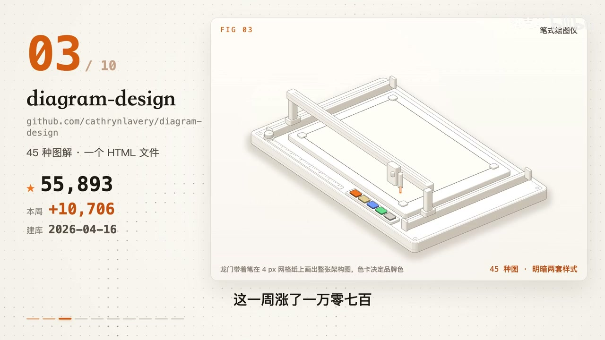
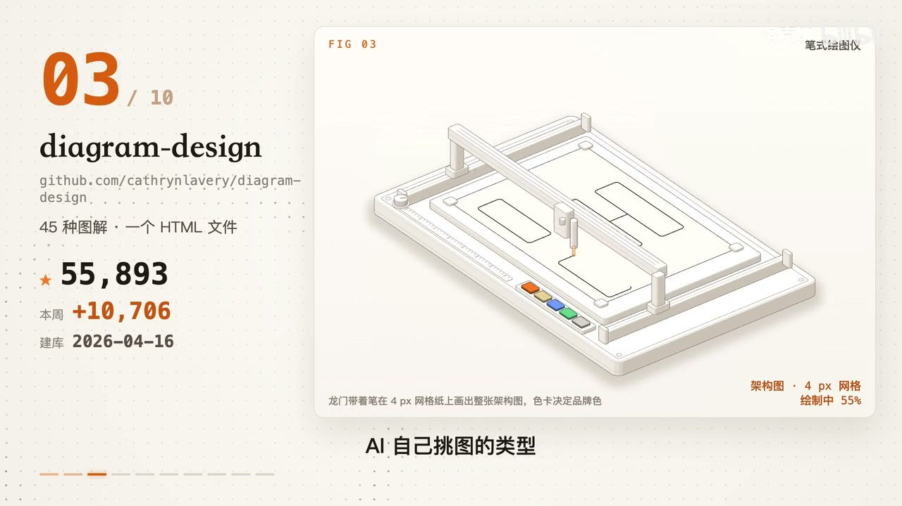

# 知识资产包：架构可视化与出版级图解 (Diagram Design)
> **资产包标识**: `ai_tech_visual_design` | **一级领域**: 🤖 AI科技与大模型
> **收录资源数**: 1 篇/条 | **沉淀知识实体**: 1 个 | **更新时间**: 2026-10-27 05:28:02
> **定位阐述**: 45种工程图解设计规范与专业SVG渲染

---
## 🌟 核心技术与工程特性对比矩阵 (Structured Knowledge Matrix)
本表由系统从收录的各篇资料中自动抽取、去重并增量融合提炼而成：

| 核心方案/实体 | 核心定位与功能 | 💻 硬件配置要求 | 🌐 运行环境与依赖 | 🔒 能否本地离线运行 | ⚡ 同类核心优势 | ⚠️ 劣势与踩坑要点 | 👥 融合来源数 |
| :--- | :--- | :--- | :--- | :--- | :--- | :--- | :---: |
| **diagram-design：一句话让 ** | 核心解决痛点: 一句话让 AI 画出专业图解；装上之后你的 AI 能多做什么: 一句话让 AI 画出专业图解，显著突破传统工作流瓶颈。 | 硬件要求: 零额外硬件配置，浏览器与标准前端环境即可 / 运行环境: SVG / Mermaid / Excalidraw 渲染器 + Node.js | 硬件要求: 零额外硬件配置，浏览器与标准前端环境即可 + 运行环境: SVG / Mermaid / Excalidraw 渲染器 + Node.js | 本地化支持: 🟢 100% 本地离线生成 (不上传架构数据，矢量图纯本地脚本导出) | • 【45 种工业级规范】全量覆盖架构图、时序图、四象限、流程图、时间线，告别丑陋默认排版。<br>• 【明暗自适应】原生适配深色模式 IDE 与浅色技术文档，视觉呈现达出版级品质。<br>• 【大白话语义映射】自然语言描述业务逻辑，AI 自动匹配最佳构图与视觉层级。 | • 【单图复杂度控制】单张图节点数超过 50 个时建议拆解为分层架构图，避免信息密度过高导致排版挤压。 | 1 篇融合 |

---

## 📋 深度结构化特征卡片详解 (Detailed Entities)
### 1. 方案实体: diagram-design：一句话让 
- **🎯 核心功能与定位**: 核心解决痛点: 一句话让 AI 画出专业图解；装上之后你的 AI 能多做什么: 一句话让 AI 画出专业图解，显著突破传统工作流瓶颈。
- **💻 硬件配置规格**: `硬件要求: 零额外硬件配置，浏览器与标准前端环境即可 / 运行环境: SVG / Mermaid / Excalidraw 渲染器 + Node.js`
- **🌐 运行环境与依赖栈**: `硬件要求: 零额外硬件配置，浏览器与标准前端环境即可 + 运行环境: SVG / Mermaid / Excalidraw 渲染器 + Node.js`
- **🔒 本地化与隐私能力**: 本地化支持: 🟢 100% 本地离线生成 (不上传架构数据，矢量图纯本地脚本导出)
- **⚡ 同类对比核心优势**:
  - 【45 种工业级规范】全量覆盖架构图、时序图、四象限、流程图、时间线，告别丑陋默认排版。
  - 【明暗自适应】原生适配深色模式 IDE 与浅色技术文档，视觉呈现达出版级品质。
  - 【大白话语义映射】自然语言描述业务逻辑，AI 自动匹配最佳构图与视觉层级。
- **⚠️ 劣势、边界与避坑踩坑要点**:
  - 【单图复杂度控制】单张图节点数超过 50 个时建议拆解为分层架构图，避免信息密度过高导致排版挤压。
- **🛠️ 上手验证常用指令**:
  ```bash
  git clone https://github.com/cathrynlavery/diagram-design
  ```
- **👥 知识贡献来源**: 洛克AI

## 📦 沉淀代码片段与模板库索引 (Code Snippets)
- [`20261027_diagram-design：一句话让_AI_画出专业图解_snip_01.sh`](snippets/20261027_diagram-design：一句话让_AI_画出专业图解_snip_01.sh)

## 🖼️ 核心视频关键帧与视觉画廊 (Keyframes Gallery)
共沉淀 **2** 张高清关键帧画面，零原视频体积，直观展示实操界面与关键节点：
- 
- 

## 📚 原始知识本地脱机存档清单 (Local Offline Archives)
> 提示：所有正文、代码与排版均已 100% 离线克隆至本地 Git 仓库，外部链接失效亦可永久脱机查阅：
- 🎬 [B站视频详解] **[diagram-design：一句话让 AI 画出专业图解](sources/20261027_bilibili_video_diagram-design：一句话让_AI_画出专业图解.md)** —— *作者: 洛克AI* | [原始链接](https://www.bilibili.com/video/BV1UAn36aEX3?t=162)
