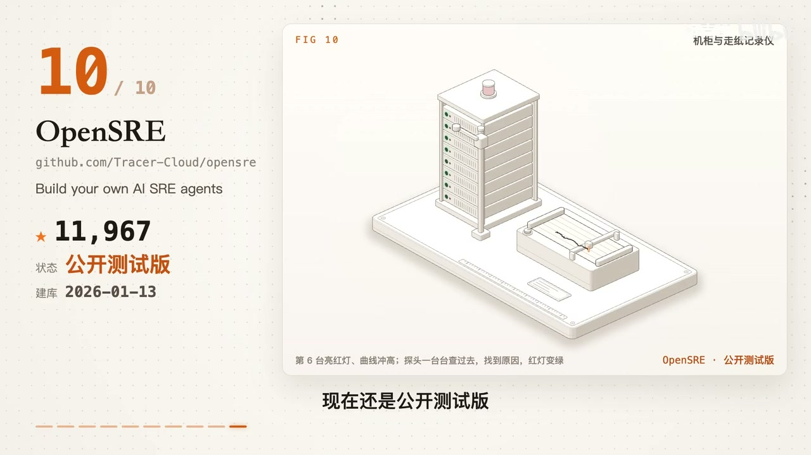
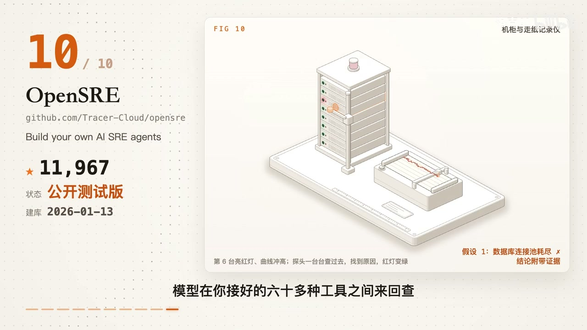

# 知识资产包：engineering_sre_devops
> **资产包标识**: `engineering_sre_devops` | **一级领域**: ⚙️ 全栈工程与系统研发
> **收录资源数**: 1 篇/条 | **沉淀知识实体**: 1 个 | **更新时间**: 2026-10-27 05:28:02
> **定位阐述**: engineering_sre_devops 相关知识沉淀与实战资产包

---
## 🌟 核心技术与工程特性对比矩阵 (Structured Knowledge Matrix)
本表由系统从收录的各篇资料中自动抽取、去重并增量融合提炼而成：

| 核心方案/实体 | 核心定位与功能 | 💻 硬件配置要求 | 🌐 运行环境与依赖 | 🔒 能否本地离线运行 | ⚡ 同类核心优势 | ⚠️ 劣势与踩坑要点 | 👥 融合来源数 |
| :--- | :--- | :--- | :--- | :--- | :--- | :--- | :---: |
| **OpenSRE：让 AI 帮你排查线上故** | 核心解决痛点: 让 AI 帮你排查线上故障；装上之后你的 AI 能多做什么: 让 AI 帮你排查线上故障，显著突破传统工作流瓶颈。 | 硬件要求: Linux 运维中控机或 Kubernetes 集群节点，轻量级容器化部署 / 运行环境: Kubernetes + Prometheus + Grafana + OpenTelemetry API | 硬件要求: Linux 运维中控机或 Kubernetes 集群节点，轻量级容器化部署 + 运行环境: Kubernetes + Prometheus + Grafana + OpenTelemetry API | 本地化支持: 🟢 100% 私有云 / VPC 内网封闭运行 (内置敏感信息打码脱敏，严防线上数据泄露) | • 【60+ 运维工具深度联动】告警一来自动拉取指标、日志、Tracing 链路与部署 Commit 并行排查。<br>• 【假设-验证闭环】提出假设、调取证据链验证假设，杜绝凭空臆测，结论 100% 附带排查依据。<br>• 【演练场自我演进】内置万种真实线上故障靶场测试，让 AI SRE 智能体持续对抗演练进化。 | • 【合规红线】严格限定合法学习或授权复刻，严禁对明确禁止逆向或商业加密混淆做对抗。<br>• 【环境排错】涉及多工具串联，遇到报错应保留完整日志并逐项单点排查，切忌全量同时修改。<br>• 【复刻边界】切忌盲目原样搬运代码或素材；复刻核心在于摸清行为逻辑后独立自研重写。 | 1 篇融合 |

---

## 📋 深度结构化特征卡片详解 (Detailed Entities)
### 1. 方案实体: OpenSRE：让 AI 帮你排查线上故
- **🎯 核心功能与定位**: 核心解决痛点: 让 AI 帮你排查线上故障；装上之后你的 AI 能多做什么: 让 AI 帮你排查线上故障，显著突破传统工作流瓶颈。
- **💻 硬件配置规格**: `硬件要求: Linux 运维中控机或 Kubernetes 集群节点，轻量级容器化部署 / 运行环境: Kubernetes + Prometheus + Grafana + OpenTelemetry API`
- **🌐 运行环境与依赖栈**: `硬件要求: Linux 运维中控机或 Kubernetes 集群节点，轻量级容器化部署 + 运行环境: Kubernetes + Prometheus + Grafana + OpenTelemetry API`
- **🔒 本地化与隐私能力**: 本地化支持: 🟢 100% 私有云 / VPC 内网封闭运行 (内置敏感信息打码脱敏，严防线上数据泄露)
- **⚡ 同类对比核心优势**:
  - 【60+ 运维工具深度联动】告警一来自动拉取指标、日志、Tracing 链路与部署 Commit 并行排查。
  - 【假设-验证闭环】提出假设、调取证据链验证假设，杜绝凭空臆测，结论 100% 附带排查依据。
  - 【演练场自我演进】内置万种真实线上故障靶场测试，让 AI SRE 智能体持续对抗演练进化。
- **⚠️ 劣势、边界与避坑踩坑要点**:
  - 【合规红线】严格限定合法学习或授权复刻，严禁对明确禁止逆向或商业加密混淆做对抗。
  - 【环境排错】涉及多工具串联，遇到报错应保留完整日志并逐项单点排查，切忌全量同时修改。
  - 【复刻边界】切忌盲目原样搬运代码或素材；复刻核心在于摸清行为逻辑后独立自研重写。
  - 【安全界限】自动化工具仅提供初步扫描，业务逻辑漏洞与敏感权限仍需人工专项复核。
- **🛠️ 上手验证常用指令**:
  ```bash
  git clone https://github.com/Tracer-Cloud/opensre
  ```
- **👥 知识贡献来源**: 洛克AI

## 📦 沉淀代码片段与模板库索引 (Code Snippets)
- [`20261027_OpenSRE：让_AI_帮你排查线上故障_snip_01.sh`](snippets/20261027_OpenSRE：让_AI_帮你排查线上故障_snip_01.sh)

## 🖼️ 核心视频关键帧与视觉画廊 (Keyframes Gallery)
共沉淀 **2** 张高清关键帧画面，零原视频体积，直观展示实操界面与关键节点：
- 
- 

## 📚 原始知识本地脱机存档清单 (Local Offline Archives)
> 提示：所有正文、代码与排版均已 100% 离线克隆至本地 Git 仓库，外部链接失效亦可永久脱机查阅：
- 🎬 [B站视频详解] **[OpenSRE：让 AI 帮你排查线上故障](sources/20261027_bilibili_video_OpenSRE：让_AI_帮你排查线上故障.md)** —— *作者: 洛克AI* | [原始链接](https://www.bilibili.com/video/BV1UAn36aEX3?t=568)
