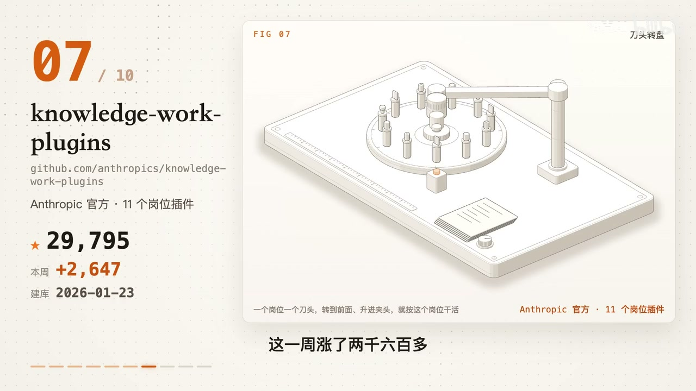
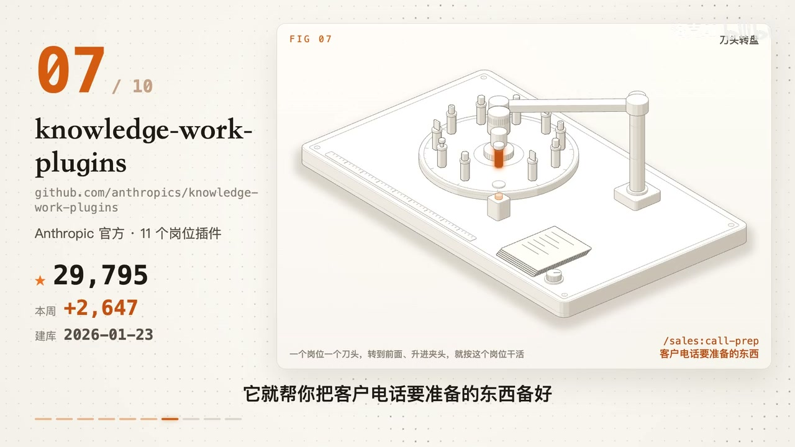

# 知识资产包：专业岗位业务自动化插件 (Work Plugins)
> **资产包标识**: `productivity_workflow_plugins` | **一级领域**: 📑 知识生产力与办公自动化
> **收录资源数**: 1 篇/条 | **沉淀知识实体**: 1 个 | **更新时间**: 2026-10-27 05:28:02
> **定位阐述**: Anthropic 官方开源11大岗位标准化工作流

---
## 🌟 核心技术与工程特性对比矩阵 (Structured Knowledge Matrix)
本表由系统从收录的各篇资料中自动抽取、去重并增量融合提炼而成：

| 核心方案/实体 | 核心定位与功能 | 💻 硬件配置要求 | 🌐 运行环境与依赖 | 🔒 能否本地离线运行 | ⚡ 同类核心优势 | ⚠️ 劣势与踩坑要点 | 👥 融合来源数 |
| :--- | :--- | :--- | :--- | :--- | :--- | :--- | :---: |
| **knowledge-work-plugi** | 核心解决痛点: Anthropic 官方出的 11 个岗位插件；装上之后你的 AI 能多做什么: Anthropic 官方出的 11 个岗位插件，显著突破传统工作流瓶颈。 | 硬件要求: 零特殊硬件要求，纯文本与规则解析 / 运行环境: Claude Cowork / Claude Code / 现代 AI 工作台 | 硬件要求: 零特殊硬件要求，纯文本与规则解析 + 运行环境: Claude Cowork / Claude Code / 现代 AI 工作台 | 本地化支持: 🟢 100% 本地明文文件 (纯 Markdown + JSON 构成，无隐藏黑盒代码，支持私有 Git 管理) | • 【Anthropic 官方规范】官方顶级研究员打磨的 11 大业务职能最佳实践与标准化工作流。<br>• 【零代码灵活定制】非技术业务人员也可直接修改 Markdown/JSON 流程，轻松融入团队内部制度。<br>• 【开箱即用高质量】大幅提升企业内部各专业岗位 Prompt 严谨度与产出合规性。 | • 【需注入企业私有先验】开箱即用模版提供框架骨架，要发挥最大价值需在配置中填入团队专属业务指标。 | 1 篇融合 |

---

## 📋 深度结构化特征卡片详解 (Detailed Entities)
### 1. 方案实体: knowledge-work-plugi
- **🎯 核心功能与定位**: 核心解决痛点: Anthropic 官方出的 11 个岗位插件；装上之后你的 AI 能多做什么: Anthropic 官方出的 11 个岗位插件，显著突破传统工作流瓶颈。
- **💻 硬件配置规格**: `硬件要求: 零特殊硬件要求，纯文本与规则解析 / 运行环境: Claude Cowork / Claude Code / 现代 AI 工作台`
- **🌐 运行环境与依赖栈**: `硬件要求: 零特殊硬件要求，纯文本与规则解析 + 运行环境: Claude Cowork / Claude Code / 现代 AI 工作台`
- **🔒 本地化与隐私能力**: 本地化支持: 🟢 100% 本地明文文件 (纯 Markdown + JSON 构成，无隐藏黑盒代码，支持私有 Git 管理)
- **⚡ 同类对比核心优势**:
  - 【Anthropic 官方规范】官方顶级研究员打磨的 11 大业务职能最佳实践与标准化工作流。
  - 【零代码灵活定制】非技术业务人员也可直接修改 Markdown/JSON 流程，轻松融入团队内部制度。
  - 【开箱即用高质量】大幅提升企业内部各专业岗位 Prompt 严谨度与产出合规性。
- **⚠️ 劣势、边界与避坑踩坑要点**:
  - 【需注入企业私有先验】开箱即用模版提供框架骨架，要发挥最大价值需在配置中填入团队专属业务指标。
- **🛠️ 上手验证常用指令**:
  ```bash
  git clone https://github.com/anthropics/knowledge-work-plugins
  ```
- **👥 知识贡献来源**: 洛克AI

## 📦 沉淀代码片段与模板库索引 (Code Snippets)
- [`20261027_knowledge-work-plugins：Anthropic_官方出的_11_个岗位插件_snip_01.sh`](snippets/20261027_knowledge-work-plugins：Anthropic_官方出的_11_个岗位插件_snip_01.sh)

## 🖼️ 核心视频关键帧与视觉画廊 (Keyframes Gallery)
共沉淀 **2** 张高清关键帧画面，零原视频体积，直观展示实操界面与关键节点：
- 
- 

## 📚 原始知识本地脱机存档清单 (Local Offline Archives)
> 提示：所有正文、代码与排版均已 100% 离线克隆至本地 Git 仓库，外部链接失效亦可永久脱机查阅：
- 🎬 [B站视频详解] **[knowledge-work-plugins：Anthropic 官方出的 11 个岗位插件](sources/20261027_bilibili_video_knowledge-work-plugins：Anthropic_官方出的_11_个岗位插件.md)** —— *作者: 洛克AI* | [原始链接](https://www.bilibili.com/video/BV1UAn36aEX3?t=389)
